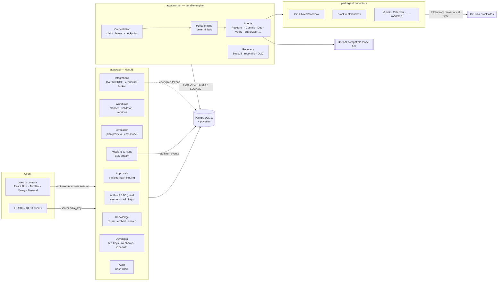
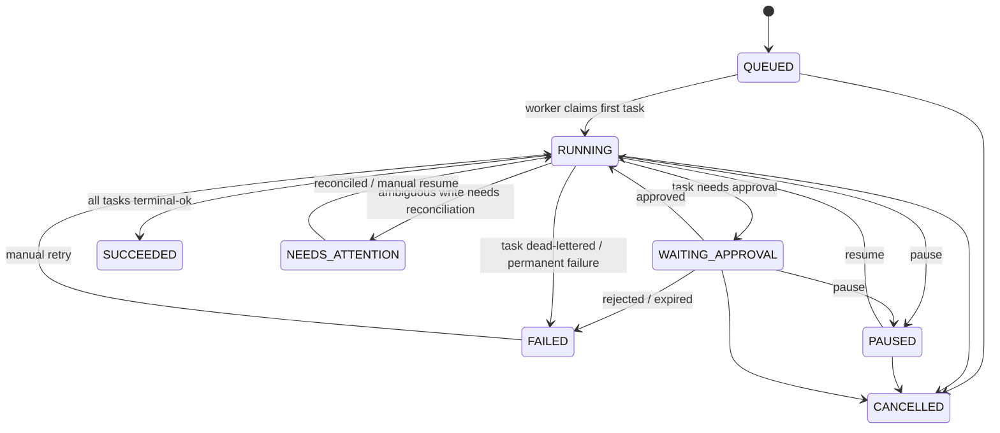

# ORBIX AI — Architecture

## System diagram



## Key decisions & assumptions

| Decision | Rationale |
|---|---|
| **PostgreSQL-backed durable engine** instead of Temporal for the MVP | The spec allows "Temporal or equivalent". Task state, leases, checkpoints and retry schedules live in Postgres rows; workers claim with `FOR UPDATE SKIP LOCKED`. One fewer service to run on Windows/local. The engine sits behind `ExecutionEngine` so a Temporal adapter can replace it. |
| API and worker are separate processes | Long workflows never live inside an HTTP request; worker can crash and resume from checkpoints. |
| SSE reads an append-only `RunEvent` table | Works across processes without Redis; poll interval 750 ms. Redis pub/sub is a drop-in later. |
| Redis is **not required** for the MVP | Rate limiting uses the in-process throttler. Listed in compose as optional for the multi-instance roadmap. |
| Deterministic model fallback | With no `ORBIX_LLM_API_KEY`, planner and summarizer use deterministic, source-grounded heuristics and every output is labelled `model: "orbix-heuristic"`. `NODE_ENV=production` refuses to boot without a real model. |
| Session cookies via Next rewrite | Browser talks to `/api/*` same-origin; cookie is `HttpOnly; SameSite=Lax`; mutations also require `X-Orbix-Request: 1` (CSRF defence in depth). |
| Path-scoped tenancy `/v1/orgs/:orgId/...` | `OrgGuard` verifies membership (or API-key org) before any handler runs; every query also filters by `organizationId`. |

## Tenancy & permission boundaries
- Every tenant-owned table has `organizationId` with an index; services take `orgId` from the guard
  context, never from the request body.
- Roles are rows (`Role.permissions: string[]`). System roles: `owner`, `admin`, `operator`,
  `approver`, `viewer`. Permissions are checked by `@RequirePermission()` per route.
- **Tool execution time checks** (worker, `policy.ts`): node action ∈ agent allowlist; connection
  belongs to the run's org and grants required scopes; run mode permits writes; risk ≥ `external_write`
  requires a valid approval whose `payloadHash` equals the hash of the payload about to be sent and
  `expiresAt > now()`; budget not exceeded.
- Retrieved documents and tool outputs are wrapped as untrusted data in prompts; they cannot change a
  node's capability, connection, or approval requirement (those come only from the published version).

## Monorepo layout

```
orbix/
├─ apps/
│  ├─ api/          NestJS REST API (auth, orgs, workflows, runs, approvals, integrations, audit, dev)
│  ├─ worker/       Durable execution worker (claims task runs, executes agents)
│  └─ web/          Next.js App Router console + marketing site
├─ packages/
│  ├─ core/         Zod schemas, workflow validator, state machines, policy, hashing, cost model
│  ├─ db/           Prisma schema, migrations, client, seed
│  ├─ connectors/   Connector interface, GitHub/Slack real + sandbox, capability registry, broker
│  ├─ engine/       Orchestrator, agents, model abstraction, planner, recovery
│  └─ sdk/          Typed TypeScript client for the public API
├─ docs/            PRD, architecture, API, state machine, plan
├─ e2e/             Playwright tests
└─ docker-compose.yml
```

## Workflow state machines

### MissionRun


### TaskRun
```
PENDING ──deps ok──▶ READY ──claim──▶ RUNNING ──ok──▶ SUCCEEDED
                       ▲                │
                       │                ├─ transient ─▶ RETRY_SCHEDULED ─(nextAttemptAt)─▶ READY
   approve ────────────┤                ├─ needs approval ─▶ WAITING_APPROVAL
                       │                ├─ permanent/permission ─▶ FAILED
                       │                ├─ attempts exhausted ─▶ DEAD_LETTER
                       │                └─ lease lost on non-idempotent write ─▶ NEEDS_RECONCILIATION
   reconcile: found ───┴──▶ SUCCEEDED ; not found ──▶ READY (same idempotency key)
```

### Outcome states (per run)
`completed` (all tasks succeeded) → `acknowledged` (provider returned an ID for each external write) →
`verified` (Verification agent read provider state back and matched the payload hash). If the
verifier cannot read evidence, the outcome stays `unverified` — never inferred.

## Scheduled triggers

A workflow whose published trigger is `{ type: "schedule", cron, timezone }` gets a `WorkflowSchedule` row on publish
(created **paused**; republishing updates cron/timezone; switching to a manual trigger removes it). Each worker calls
`Scheduler.fireDue()` every `ORBIX_SCHEDULER_INTERVAL_MS` (15 s):

1. In one transaction, due rows are claimed with `FOR UPDATE SKIP LOCKED` and `nextRunAt` is advanced to the next slot
   **after now** — concurrent workers never both see a slot, and missed slots after downtime are not replayed.
2. A run is created with `(scheduleId, scheduledFor)`, which is **unique** in the database — a second guard against
   double execution.
3. If the previous scheduled run is still active, or the workflow is not ready (e.g. live mode with a revoked
   connection), the slot is skipped and the reason is stored in `lastError` and the audit log.

Scheduled runs are ordinary runs: every external write still pauses for payload-bound approval. Cron is evaluated
in the schedule's IANA timezone (DST-aware) and limited to one fire per 5 minutes. All raw SQL compares timestamps in
UTC explicitly (`now() AT TIME ZONE 'UTC'`), because Prisma stores UTC in `timestamp without time zone` columns and
the database session timezone may differ.

## Failure taxonomy & recovery

| Class | Examples | Action |
|---|---|---|
| `transient` | 5xx, timeouts, network reset | Retry with exponential backoff + full jitter, bounded by node policy |
| `rate_limited` | 429, Slack `ratelimited` | Retry at `max(retryAfter, backoff)` |
| `permission` | 401/403, missing scope, revoked token | Fail task, flag connection, no retry |
| `permanent` | 4xx validation, not found | Fail task, no retry |
| `ambiguous` | Timeout or lease loss **after** a non-idempotent write was sent | `NEEDS_RECONCILIATION`; reconcile against provider (Slack: message metadata carries idempotency key) before any retry |

Financial/destructive capabilities are registered with `maxAttempts: 1` and `retryable: false`
enforced by the validator regardless of user edits.
